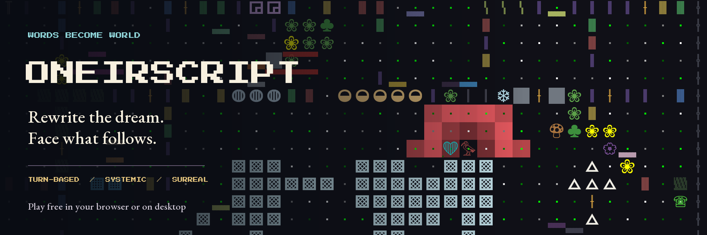
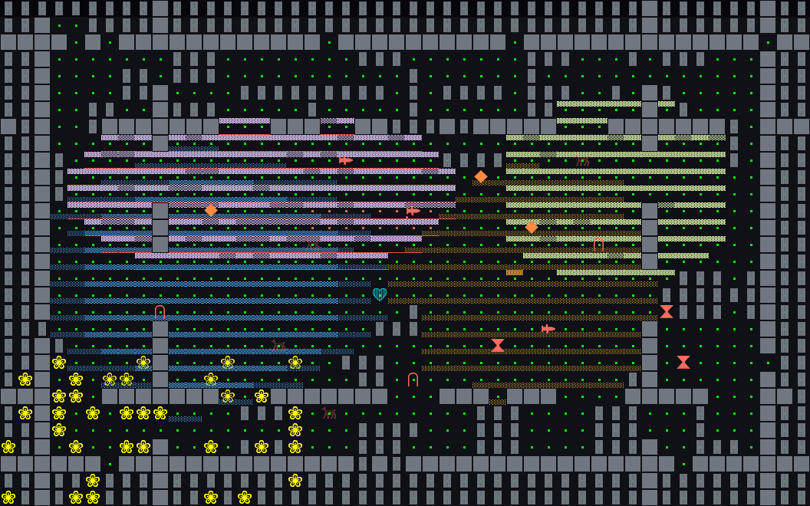
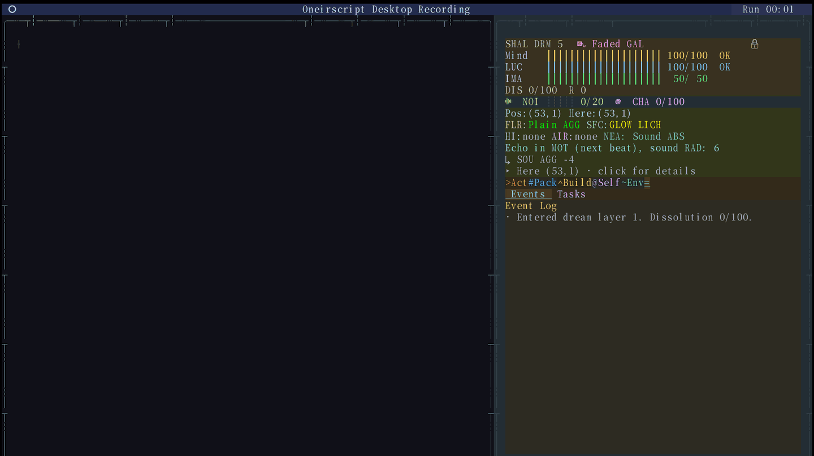
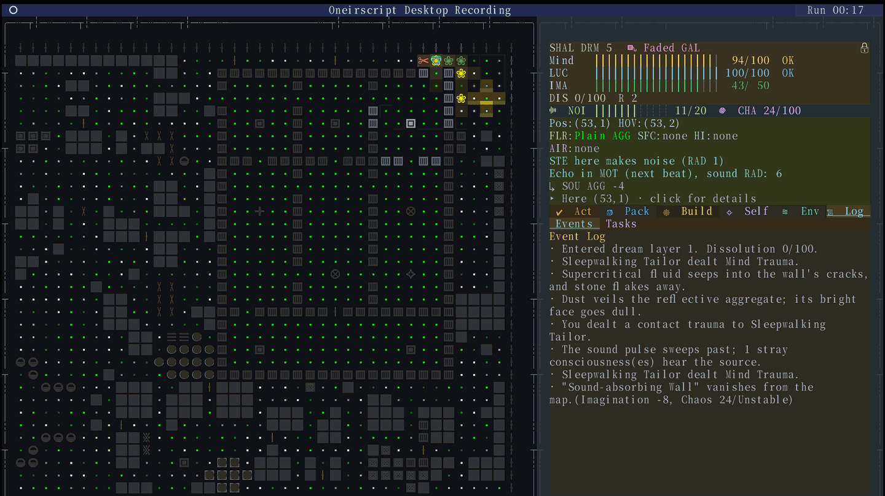
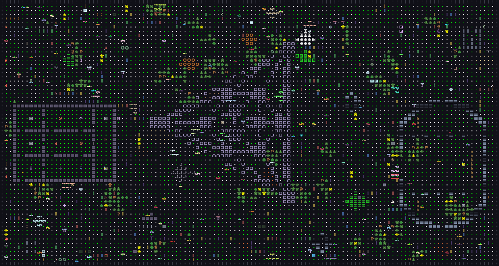

# 梦层 / Oneirscript



> 在梦里，文字可以被篡改，环境可以被利用，离开的路需要自己找到。

**传统 Roguelike · 单人 · 网格回合制 · 程序生成 · 失败重开**

简体中文 · [English](README_EN.md) · [项目首页](README.md)

<a id="zh"></a>

**目录**

- [游戏简介](#zh-overview)
- [截图与实机演示](#zh-gallery)
- [核心玩法](#zh-features)
- [下载](#zh-download)
- [开始游玩](#zh-play)
- [从源码运行](#zh-source)
- [技术介绍](#zh-technical)
- [反馈与参与](#zh-contribute)
- [开源许可](#zh-license)
- [AI 辅助开发、分支授权与贡献审核](#zh-ai-policy)

<a id="zh-overview"></a>

## 游戏简介

**《梦层》是一款以潜意识为舞台的传统 Roguelike：网格探索、回合制行动、程序生成，以及失败后重新开始的一局。** 你从「梦的起始」醒来，穿过不断变化的梦境，面对游荡的异象、散落的记忆和更深处的核心执念。观察、走位、资源管理和对规则的理解共同决定你能走多远。

**你可以编排自己的行动规则，也可以改写眼前的现实。** 把装备盘上的词条组织成带有条件、目标和行为的语句；从环境或对话的描述中选择可修改的字词，预览结果，支付代价，再观察它如何改变局面。液体、气体、火焰、光照和声音则为这些选择提供真实的战术条件。

一局的基本循环是：**观察与探索 → 处理遭遇、事件和环境 → 调整构筑 → 累积崩解度 → 决定继续搜寻或下潜**。你需要判断何时战斗、何时绕行、何时消耗资源改写局面，以及何时带着已有收获离开当前梦层。

游戏仍在持续开发和调整。当前以终端为主要载体，使用 Python 与 Textual 构建，提供中文和英文界面。

[返回目录](#zh) · [English](README_EN.md#en-overview)

<a id="zh-gallery"></a>

## 截图与实机演示

### 环境连锁反应

爆炸、火焰与电场在真实游戏引擎中发生和蔓延；此段使用提前布置的演示场景。



### 在实战地图中篡改现实

英文桌面版实机录屏：选择篡改词，预览改写结果与费用，再在生成的战斗地图中执行。



### 组织装备语句

英文桌面版实机录屏：拿起、移动、旋转装备，放置功能词，并在战斗中展示构筑的作用。



### 更大视角的梦境地图



画面来自开发构建，可能与本仓库源码快照存在差异。全图使用全知视角，环境反应为引擎内布置演示；篡改与装备 GIF 均录自生成地图中的桌面游戏。[素材说明](assets/readme/README.md)。

<a id="zh-features"></a>

## 核心玩法

| 玩法特色 | 实际玩点 |
|---|---|
| **用语句构筑自身** | 在联想盘上组织条件、目标和行为，阅读生效语句，再用实际行动验证组合。构筑的取舍涉及触发条件、作用对象和追加效果。 |
| **把篡改作为战术行动** | 改写眼前环境或对话中的可编辑内容，预览结果，再权衡想象力费用、混乱与风险。需要决定什么值得改、何时改，以及是否保留资源给后面的危机。 |
| **利用相互作用的环境** | 借助声音诱引、光照与遮挡判断路线，利用积液传导、火焰蔓延和液气反应处理敌人与地形。多个系统可以参与同一次遭遇。 |
| **在随机局势中找解法** | 程序生成的房间、洞穴、走廊与迷宫，配合不同的异象、物资和异常地点，让路线、遭遇与可用手段发生变化。 |
| **探索梦境中的分支与选择** | 进入拥有独立内容的「梦中梦」，处理 NPC、事件、机关和支线目标，逐步接近核心执念与不同终局。 |
| **通过观察学习规则** | 用观察、图鉴与详情理解威胁；结合构想、记忆碎片和洞察调整手段，把本局获得的知识带进下一次尝试。 |

心智、清醒度与想象力各有用途；征兆、噪音和混乱也会影响局面。玩点在于根据本局的装备、能力和环境作出取舍，找到自己能够承担代价的解法。

[返回目录](#zh) · [English](README_EN.md#en-features)

<a id="zh-download"></a>

## 下载

**下载 v0.1.1：** 按系统与处理器选择发行包。

| Platform / 平台 | Package / 发行包 |
|---|---|
| Windows x64 | [Download / 下载](https://github.com/dis5mZl1e/oneirscript/releases/download/v0.1.1/Oneirscript-v0.1.1-20261101-Windows-x86_64-zh.zip) |
| Linux x64 | [Download / 下载](https://github.com/dis5mZl1e/oneirscript/releases/download/v0.1.1/Oneirscript-v0.1.1-20261101-Linux-x86_64-zh.tar.gz) |
| macOS Apple Silicon | [Download / 下载](https://github.com/dis5mZl1e/oneirscript/releases/download/v0.1.1/Oneirscript-v0.1.1-20261101-macOS-arm64-zh.zip) |
| macOS Intel | [Download / 下载](https://github.com/dis5mZl1e/oneirscript/releases/download/v0.1.1/Oneirscript-v0.1.1-20261101-macOS-Intel-zh.zip) |

[All release files, source and checksums / 全部文件、源码与校验值](https://github.com/dis5mZl1e/oneirscript/releases/tag/v0.1.1)

请完整解压。桌面包已包含终端与字体，无需安装 Python。macOS 包未签名、未公证，若被拦截请在“系统设置 → 隐私与安全性”选择“仍要打开”；Linux 需要图形桌面。

[返回目录](#zh) · [English](README_EN.md#en-download)

<a id="zh-play"></a>

## 开始游玩

1. 下载对应平台的完整发行包，解压整个目录，保留随附的 `assets` 与 `vendor` 等资源。
2. 使用包内的游戏启动入口。游戏优先使用随包 WezTerm 及专用字体配置；也保留其他终端的兼容启动方式。
3. 开始新游戏，从 0 层教学熟悉观察、行动和环境互动，再逐步探索其他系统。

**推荐使用随包 WezTerm。** 它负责游戏的字体与图像地图显示，专用窗口配置与个人全局配置分开。其他终端可以使用字符地图，但字体、颜色和鼠标表现会受终端能力影响。

以下为默认常用键位。字母以大写标注，无须按住 Shift；瞄准、编辑器、弹窗和面板会按当前上下文接管部分按键。

| 按键 | 操作 |
|---|---|
| `方向键 / 小键盘` | 地图移动；小键盘支持斜向 |
| `WASD` | 右侧面板选择与分类切换 |
| `/` | 切换地图／面板焦点 |
| `.` | 等待一回合 |
| `Enter` | 行动／确认当前选择 |
| `G / E` | 收纳物品／回应地点或对象 |
| `Tab` | 打开行囊；瞄准时切到自由落点 |
| `U` | 使用物品；也可从行囊选择后确认 |
| `F` | 进入瞄准；瞄准中再按查看发射来源 |
| `O` | 瞄准时切换合法敌方目标 |
| `Q` | 投掷瞄准；面板中返回 |
| `R` | 为当前发射来源换弹 |
| `X` | 观察；观察时 Enter 前往选中位置 |
| `右键` | 查看格子或物品详情／上下文操作 |
| `H / ?` | 操作与帮助；选择可用构想等行动 |
| `T / [` | 携带意象页面／联想盘编辑器 |
| `C` | 篡改可编辑的对话或眼前文字 |
| `V / I / K` | 征兆／现实洞察／观测 |
| `J` | 任务日志 |
| `Alt+S / Alt+N` | 自我察觉／噪音与混乱详情 |
| `F3` | 分层观察；观察内 Tab 切层 |
| `N / B` | 满足条件后下潜／回溯 |
| `Esc` | 取消或逐级返回；无待取消状态时暂停 |
| `F10` | 保存并返回主页；主页再按退出 |
| `Alt+H / Alt+Z` | 完整键位表／展开或收起底栏 |

**角色移动优先使用方向键／小键盘；WASD 主要用于右侧面板。** 用 `/` 切换地图与面板焦点。鼠标左键用于选择、移动和行动，滚轮用于滚动列表。完整说明可随时按 `Alt+H` 查看，具体操作以游戏内提示与设置为准。

界面语言、音量及显示选项可在设置中调整。更新游戏前请备份存档。

[返回目录](#zh) · [English](README_EN.md#en-play)

<a id="zh-source"></a>

## 从源码运行

需要 **Python 3.11 或更新版本**。取得源码后，在项目根目录运行；以下方式使用独立虚拟环境，无需修改系统 Python。

**Windows（PowerShell）**

```powershell
python -m venv .venv
.\.venv\Scripts\python.exe -m pip install -r requirements.txt
.\.venv\Scripts\python.exe run_demo.py
```

**macOS / Linux**

```bash
python3 -m venv .venv
.venv/bin/python -m pip install -r requirements.txt
.venv/bin/python run_demo.py
```

需要留在当前终端时，在运行命令末尾添加 `--compat-terminal`。源码依赖的安装需要网络；源码目录不一定包含对应平台的便携终端。

开发者可用以下命令执行不进入交互界面的冒烟检查，并将测试存档写入单独目录：

```bash
python run_demo.py --smoke --save-dir save-smoke
```

代码导航与开发检查见 [TECHNICAL_CN.md](TECHNICAL_CN.md)。本仓库包含 `build.py` 和 `scripts/` 中的原生构建配方；重新打包时在运行依赖之外安装 `requirements-build.txt`。

[返回目录](#zh) · [English](README_EN.md#en-source)

### 安装 Python 分发包

v0.1.1 Release 以桌面包和对应源码包为主；Python 3.11+ 的 wheel 与源码分发包仍保留在 [v0.1.0 Release](https://github.com/dis5mZl1e/oneirscript/releases/tag/v0.1.0)。如需使用，下载该版本的 wheel 后安装并启动：

```sh
python -m pip install oneirscript-0.1.0-py3-none-any.whl
oneirscript
```

Python 包包含字体、音频与特效纹理；命令将配置和存档写入用户的平台数据目录，不写入 site-packages。
WezTerm 仍是外部终端，首次正常启动可能需要联网下载；`oneirscript --compat-terminal` 使用当前终端。

<a id="zh-technical"></a>

## 技术介绍

游戏使用 Python 3.11+、Textual/Rich、NumPy、Pillow/FontTools、asciimatics 与 pygame，推荐以 WezTerm 为终端宿主。会话命令连接界面与游戏规则，装备编译、篡改结算、环境模拟和地图呈现各自组织。

完整的架构图、代码导航、系统实现与冒烟检查命令见 [技术介绍与开发导航](TECHNICAL_CN.md)。本仓库包含桌面源码、运行资源和基础原生构建配方；网页版、便携终端二进制及维护者完整测试和 CI 工具链不随仓库提供。

<a id="zh-contribute"></a>

## 反馈与参与

提交权限、设计方向、提交者审查责任与合并标准见 [英文主要贡献指南](CONTRIBUTING.md)，
另提供 [中文参考译文](CONTRIBUTING_CN.md)。

欢迎反馈问题、分享游玩体验，以及参与翻译、内容创作和程序改进。可以使用所在代码托管平台的问题区与合并请求功能。

报告问题时，请尽量附上：游戏版本、系统与终端、复现步骤、预期与实际结果；有截图或报错日志时一并提供。分享存档和日志前，请先检查其中是否包含个人信息。


完整测试套件与开发工具不包含在本精简仓库中；可运行的检查见 [技术指南](TECHNICAL_CN.md#开发验证)，贡献审核要求见下方 [AI 与贡献政策](#zh-ai-policy)。

[返回目录](#zh) · [English](README_EN.md#en-contribute)

<a id="zh-license"></a>

## 开源许可

**项目自有代码采用 [GNU GPLv3（GPL-3.0-only）](LICENSE)。** 允许商业使用、修改和分发；分发受许可覆盖的程序与修改版时，需要遵守 GPLv3 的对应源码等要求。

字体、图标、原创音频、WezTerm 及其他第三方组件分别适用其独立许可，不统一改为 GPL。完整范围见 [LICENSING.md](LICENSING.md)，来源与声明见 [THIRD-PARTY-NOTICES.md](THIRD-PARTY-NOTICES.md)。

Copyright (c) 2026 dis5mZl1e。项目名称、标识与官方身份的使用，不因代码许可自动获得背书。

[返回目录](#zh) · [English](README_EN.md#en-license)

---

<a id="zh-ai-policy"></a>

## AI 辅助开发、分支授权与贡献审核

### AI 辅助开发说明

本游戏的开发过程中使用了人工智能工具辅助编写、修改和分析部分程序代码。AI 辅助是本项目开发方式的一部分，不代表全部代码均由 AI 生成，也不构成对代码正确性、安全性、原创性或第三方权利状况的保证。是否使用 AI，不改变相关代码和资源各自适用的许可证，也不免除提交者对其贡献的理解、审核与验证责任。

### 独立分支与改版的授权

在遵守 [GNU GPLv3（GPL-3.0-only）](LICENSE)及相关资源独立许可的前提下，任何人均可创建、维护和分发本项目的开源分支、修改版或其他衍生版本，无须仅因创建或发布此类版本而另行取得原作者的逐项批准。修改和分发时，应保留适用的版权及许可声明，明确标示修改事实，并按 GPLv3 的适用要求向接收者提供对应源码。本说明不要求将仅供私人使用的修改一律向公众公开，也不授予将受 GPL 覆盖的衍生作品任意改为不兼容许可证的权利。字体、图标、音频等资源继续适用各自的许可，详见 [许可边界](LICENSING.md)与[第三方声明](THIRD-PARTY-NOTICES.md)。

### 非官方版本的责任与标识

独立分支和改版不因其来源于本项目、公开源代码或曾向本项目提交合并请求，即成为官方版本或获得原作者背书。发布此类版本时，请清楚说明其维护者、与原项目的关系及修改情况，避免使使用者误认为其由原作者发布、审核、维护或提供支持。

除适用法律另有规定或原作者另行作出书面承诺外，原作者不承诺审查、维护、更新或支持任何独立分支和改版，不保证其功能、稳定性、安全性、兼容性或存档完整性，也不因其使用、分发或维护情况而自动承担责任。此类版本的问题与支持请求应首先联系其实际维护者。软件的无担保及责任限制，以 [LICENSE](LICENSE)及适用法律为准；本说明不排除法律规定不得排除的责任，也不保证官方版本不存在缺陷。

### AI 辅助贡献与合并请求

本项目接受经过人工审核的 AI 辅助代码合并请求。提交者应在提交前完成实质性的人工检查，能够解释所提交代码的工作方式、修改目的和主要风险；仅由 AI 自行检查或确认，不视为已经完成人工审核。

提交时应提供以下信息：

- 修改所解决的问题、实现方式、影响范围及已知限制。
- AI 辅助的使用情况与主要涉及范围；无需提供包含个人信息、凭据或其他敏感内容的完整提示词或会话记录。
- 已完成人工审核的说明，以及实际执行的测试、运行环境、结果和仍未验证的部分。未执行的测试不得描述为已通过。
- 新增或引用代码、依赖和素材的来源及适用许可；提交者应确认有权提交相关内容，并以与项目相容的许可供项目接收，不得包含无权披露的专有代码、凭据或个人信息。

原作者仅会在对拟合并改动进行必要测试和审查后，才考虑是否将其合并至主项目。测试通过是考虑合并的必要条件，并不构成合并承诺；项目方向、可维护性、安全性、兼容性、许可合规和审核成本同样属于判断依据。作者可以要求补充材料、修改或拆分请求，也可以暂缓或拒绝合并，且不承诺固定的审核或合并时限。提交合并请求不自动转移提交者的著作权，也不意味着作者接受对独立分支的持续维护责任。

### 说明的适用范围

上述贡献要求适用于请求合并至本项目的改动，不构成对 GPL 所授予的独立使用、修改及分发权利的额外限制，也不要求独立分支沿用本项目的审核流程。无论是否使用 AI，许可证及第三方资源声明均应得到遵守。本节是开发方式、责任边界和贡献流程的说明，不替代或修改许可证正文；具体权利义务以 [LICENSE](LICENSE)、各资源适用的许可及适用法律为准。

[返回目录](#zh) · [English](README_EN.md#en-ai-policy)

感谢 OpenAI Codex 与 DeepSeek 为本项目提供代码编写与开发支持。
