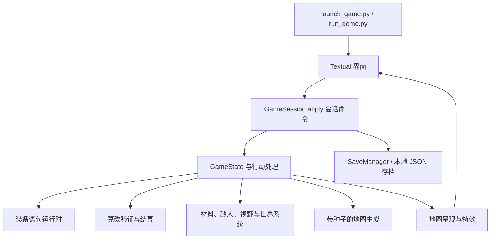

# 梦层：技术介绍与开发导航

[English](TECHNICAL_EN.md) · [项目首页](README.md) · [游玩指南](README_CN.md)

## 仓库范围

这是 Python 桌面游戏的源码精简仓库，包含游戏规则、终端界面、地图生成、内容定义、字体和音频。
本仓库包含基础原生构建配方。各平台二进制发布在 Releases；网页版前端、便携 WezTerm 二进制及维护者完整测试与 CI 工具链不在源码目录中。
README 的开发画面可能录自较新的桌面构建，用于展示玩法，不代表与当前源码快照逐项一致。

## 运行环境与技术栈

需要 **Python 3.11 或更新版本**。依赖范围以 [requirements.txt](requirements.txt) 和 [pyproject.toml](pyproject.toml) 为准。

| 组件 | 职责 |
|---|---|
| Textual、Rich | 应用生命周期、面板布局、键鼠输入、终端富文本 |
| NumPy | 模拟与渲染中的数组运算 |
| Pillow、FontTools | 图像地图栅格化、字体与字形处理 |
| asciimatics | 离屏特效生成 |
| pygame | 音频播放 |
| WezTerm | 推荐的外部终端宿主，提供预期的字格几何与图像输出能力 |

WezTerm 承载显示，不执行游戏规则。启动器可以准备游戏专用配置并将 Python 进程交给它运行。
兼容模式保留当前终端，其字体、图像、颜色和输入表现取决于终端能力。
入口见 [terminal_launch.py](dream_demo/terminal_launch.py) 和 [wezterm_setup.py](dream_demo/wezterm_setup.py)。

## 架构与目录导航



| 位置 | 职责 |
|---|---|
| [run_demo.py](run_demo.py)、[launch_game.py](launch_game.py) | 源码与打包态启动、终端交接、冒烟参数 |
| [dream_demo/persistence.py](dream_demo/persistence.py) | 会话命令分派、存档槽、历史与恢复处理 |
| [dream_demo/core/](dream_demo/core/) | 游戏状态、行动、战斗、敌人行为、视野、声音与模拟 |
| [dream_demo/mapgen/](dream_demo/mapgen/) | 程序生成布局与 vault 模板 |
| [dream_demo/equipment/](dream_demo/equipment/) | 盘面放置、读取顺序、词义、语句编译与执行 |
| [dream_demo/materials/](dream_demo/materials/) | 材料定义与反应配方 |
| [dream_demo/data/](dream_demo/data/) | 构想、异象、对话等内容定义 |
| [dream_demo/ui/](dream_demo/ui/) | 输入路由、面板、编辑器、地图呈现与反馈 |
| [dream_demo/i18n.py](dream_demo/i18n.py) | 语言选择与翻译入口 |
| [assets/](assets/) | 字体、特效纹理、音频、署名与许可声明 |

## 核心系统如何落地

**语法装备。** 装备占据空间盘面，位置、读取顺序、旋转、列角色和功能词共同决定解释。
编译结果形成可执行的构型与语句；仅占据格子不保证效果生效。
阅读入口：[board.py](dream_demo/equipment/board.py)、[reading.py](dream_demo/equipment/reading.py)、
[grammar.py](dream_demo/equipment/grammar.py)、[positional.py](dream_demo/equipment/positional.py)、
[runtime.py](dream_demo/equipment/runtime.py)。

**现实篡改。** 可编辑描述与对话通过预先定义的选项、验证和预览实现，是本地规则系统，不调用在线生成式 AI 服务。
地图与对话篡改共用想象力费用、混乱度、序号、行动时间和风险结算；具体效果写入与回滚仍由各自调用方处理。
入口：[tamper_pipeline.py](dream_demo/core/tamper_pipeline.py)、[tamper_world.py](dream_demo/data/tamper_world.py)。

**环境战术。** 材料配方与模拟处理液体、气体、火焰等交互，战斗、声音传播、光照与可见性共同作用于世界状态。
显示特效用于呈现模拟结果，不能替代规则结算。
入口：[reactions.py](dream_demo/materials/reactions.py)、[materials_sim.py](dream_demo/core/materials_sim.py)、
[acoustics.py](dream_demo/core/acoustics.py)。

**地图显示。** 字符与图像呈现共用字形信息，图像地图使用字体感知的栅格化，周边面板与反馈由终端界面承载。
规则回合与显示动画分开处理；一次动画刷新不等于推进一次玩家行动。
入口：[map_presentation.py](dream_demo/ui/map_presentation.py)、[world_renderer.py](dream_demo/ui/world_renderer.py)、
[live_map.py](dream_demo/ui/live_map.py)。

**生成与存档。** 种子影响生成布局，但不保证代码或内容变化后仍能复现同一局。
本地存档记录运行状态与历史，切换版本前应备份；旧源码快照与新桌面发行版的存档兼容性不能直接假定。

## 开发验证

提交与审查要求以 [英文贡献指南](CONTRIBUTING.md) 为主要说明，另见 [中文参考译文](CONTRIBUTING_CN.md)。

先按 [README_CN.md](README_CN.md#zh-source) 创建虚拟环境并安装依赖，各项检查使用独立的测试存档目录：

```sh
python run_demo.py --smoke --save-dir save-smoke
python run_demo.py --smoke --image-smoke --save-dir save-image-smoke
python run_demo.py --smoke --fx-smoke --save-dir save-fx-smoke
```

基础检查创建会话并渲染一帧，不进入交互终端；图像检查额外生成 PNG 并探测映射字形；特效检查运行离屏效果诊断。
这些属于冒烟检查，不能替代维护者完整测试套件或各平台实机验证。

提交改动前，应实际检查受影响的控件与面板，相关改动还需核对中英文显示。
报告运行过的命令、环境、结果和未验证项，不将未执行的测试写成通过。
贡献审核沿用 [现有贡献与 AI 政策](README_CN.md#zh-ai-policy)。

报告问题时附上源码提交、操作系统、Python 版本、终端、复现步骤、预期与实际结果及相关日志。
分享日志与存档前删除个人信息和凭据，不在公开 issue 中披露安全敏感细节。

## 源码与发行包对应关系

`DESKTOP-SOURCE.json` 记录了从开发提交 `fcc3349` 导入的 v0.1.0 桌面源码。
`desktop-source-v0.1.0` 标签保留原始基线；Release 提供独立的对应源码 ZIP，压缩包路径为 ASCII，
并附原开发路径还原脚本。当前分支额外加入 Python 安装态资源定位和可写数据目录的命令入口。
现有桌面二进制保持原样，校验值随 Release 提供。

重新构建桌面包时，安装运行依赖和 `requirements-build.txt`，执行
`python scripts/prepare_portable_terminal.py` 准备对应平台终端，再运行 `python build.py` 与
`scripts/build_portable_bundle.py`。需要在目标操作系统构建，不能靠改文件名把 Windows/Linux 产物变为已验证的 macOS 包。

构建 Python wheel/sdist 时，先安装 `build` 包，并在仓库外的目录执行
`python -m build /path/to/oneirscript`，避免仓库的原生 `build.py` 遮蔽 Python 构建前端。
wheel 将运行资源打入 `dream_demo/_assets`，源码目录继续使用 `assets`；原生桌面包保留原冻结资源布局。

## 许可

项目自有代码采用 [GPL-3.0-only](LICENSE)，字体、音频、图标与外部组件保留各自的声明。
分发资源或二进制前，请阅读 [许可边界](LICENSING.md)、[第三方声明](THIRD-PARTY-NOTICES.md)和
[音频署名](assets/CREDITS.md)。
