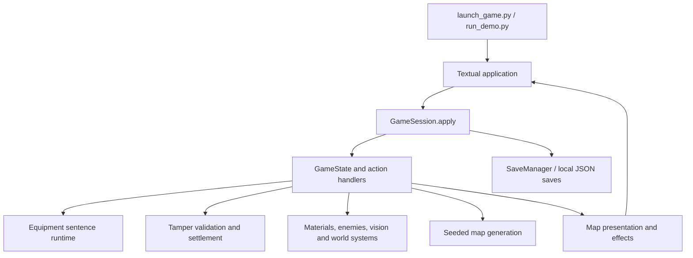

# Oneirscript: technical guide

[简体中文](TECHNICAL_CN.md) · [Project home](README.md) · [Player guide](README_EN.md)

## Repository scope

This is the source-focused repository for the Python desktop game. It contains
the game rules, terminal UI, procedural generation, content definitions, fonts,
and audio. The web frontend, platform release binaries, portable WezTerm vendor
directory, maintainer build scripts, and full test suite are not included.
Development captures in the README may come from a newer desktop build; they
illustrate the systems rather than certify an exact source/release match.

## Runtime and dependencies

Python **3.11 or later** is required. Install the versions declared in
[requirements.txt](requirements.txt); package metadata is in [pyproject.toml](pyproject.toml).

| Component | Role |
|---|---|
| Textual + Rich | Application lifecycle, panels, keyboard/mouse input, styled terminal text |
| NumPy | Array operations used by simulation and rendering |
| Pillow + FontTools | Image-map rasterization and font/glyph handling |
| asciimatics | Offscreen effect generation |
| pygame | Audio playback |
| WezTerm | Recommended external terminal for the intended glyph geometry and image output |

WezTerm is a terminal host, not the rules engine. The launcher can prepare a
private configuration and hand the Python process to it. Compatibility mode
keeps the current terminal, whose font, image, color, and input capabilities vary.
See [terminal_launch.py](dream_demo/terminal_launch.py) and
[wezterm_setup.py](dream_demo/wezterm_setup.py).

## Architecture and code map



| Location | Responsibility |
|---|---|
| [run_demo.py](run_demo.py), [launch_game.py](launch_game.py) | Source/frozen launch paths, terminal handoff, smoke options |
| [dream_demo/persistence.py](dream_demo/persistence.py) | Session command dispatch, saves, slots, history and recovery handling |
| [dream_demo/core/](dream_demo/core/) | Game state, actions, combat, enemy behavior, visibility, sound and simulation |
| [dream_demo/mapgen/](dream_demo/mapgen/) | Procedural layouts and vault templates |
| [dream_demo/equipment/](dream_demo/equipment/) | Board placements, reading order, meanings, sentence compilation and execution |
| [dream_demo/materials/](dream_demo/materials/) | Material definitions and reaction recipes |
| [dream_demo/data/](dream_demo/data/) | Definitions for abilities, anomalies, dialogue and other content |
| [dream_demo/ui/](dream_demo/ui/) | Input routing, panels, editors, map presentation and visual feedback |
| [dream_demo/i18n.py](dream_demo/i18n.py) | Language selection and translation entry points |
| [assets/](assets/) | Fonts, effect textures, audio, credits and license notices |

## How the distinctive systems work

**Equipment sentences.** Equipment occupies a spatial board. Placement, reading
order, rotation, column roles and function words determine interpretations.
Compilation produces actionable formations/sentences; merely occupying a slot
does not guarantee an active effect. Start with [board.py](dream_demo/equipment/board.py),
[reading.py](dream_demo/equipment/reading.py),
[grammar.py](dream_demo/equipment/grammar.py),
[positional.py](dream_demo/equipment/positional.py), and
[runtime.py](dream_demo/equipment/runtime.py).

**Reality tampering.** Editable descriptions and dialogue use defined choices,
validation and previews. This is a local rules system, not an online generative
AI service. World and dialogue edits share settlement helpers for imagination
costs, chaos, sequence tracking, action time and risk. Effect application and
rollback remain with their respective callers. See
[tamper_pipeline.py](dream_demo/core/tamper_pipeline.py) and
[tamper_world.py](dream_demo/data/tamper_world.py).

**Environmental tactics.** Material recipes and simulation handle liquid/gas
interactions alongside fire and other hazards. Combat, acoustics, light and
visibility interact with world state. Visual effects present these outcomes;
they are not a substitute for the simulation. See
[reactions.py](dream_demo/materials/reactions.py),
[materials_sim.py](dream_demo/core/materials_sim.py), and
[acoustics.py](dream_demo/core/acoustics.py).

**Map output.** Character and image presentation share glyph information.
Font-aware rasterization supports the image map, while the terminal UI supplies
panels and feedback. Turn-based rules and display animation are separate
concerns: an animation frame is not itself a player turn. See
[map_presentation.py](dream_demo/ui/map_presentation.py),
[render.py](dream_demo/ui/render.py), and
[live_map.py](dream_demo/ui/live_map.py).

**Generation and saves.** Seeds influence generated layouts, but a seed alone
does not promise identical runs across changed code or content. Local saves
contain run state and history; back them up before switching versions. Do not
assume compatibility between an older checkout and a newer desktop release.

## Development checks

For submission and review requirements, start with [CONTRIBUTING.md](CONTRIBUTING.md).

Use the virtual-environment setup in [README_EN.md](README_EN.md#en-source).
Run each check with its own disposable save directory:

```sh
python run_demo.py --smoke --save-dir save-smoke
python run_demo.py --smoke --image-smoke --save-dir save-image-smoke
python run_demo.py --smoke --fx-smoke --save-dir save-fx-smoke
```

The basic check starts a session and renders a frame without an interactive
terminal. The image check also renders a PNG and probes mapped glyphs; the
effects check exercises offscreen effects. These are smoke checks, not a
replacement for the maintainer's full suite or native platform testing.

Before proposing a change, check the affected controls and panels interactively,
including English/Chinese labels where relevant. Report the exact checks run,
environment, results, and remaining limitations. Never describe unrun tests as
passing. Follow the [contribution and AI review policy](README_EN.md#en-ai-policy).

For bug reports, include the checkout commit, OS, Python version, terminal,
reproduction steps, expected/actual behavior, and relevant logs. Remove personal
information and credentials from logs or saves. Do not post security-sensitive
details in a public issue.

## Licensing

Project-owned code uses [GPL-3.0-only](LICENSE). Fonts, audio, icons and external
components have their own notices. Consult [LICENSING.md](LICENSING.md),
[THIRD-PARTY-NOTICES.md](THIRD-PARTY-NOTICES.md), and
[assets/CREDITS.md](assets/CREDITS.md) before redistributing assets or binaries.
